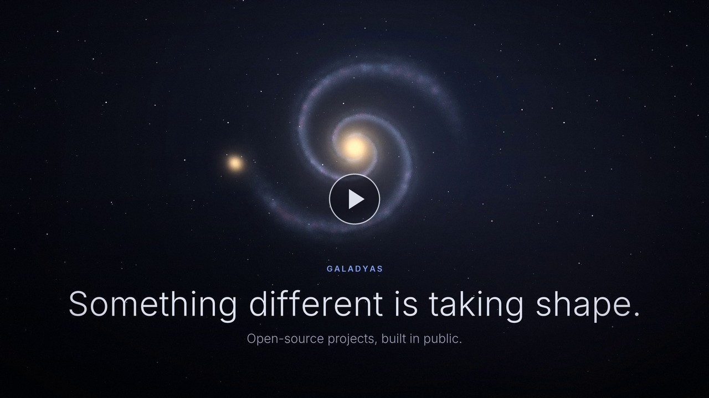

# galadyas

**Open-source projects, built in public.**

Technology works best when it serves people: their time, their privacy, their trust.

*Watch the teaser (18 s)*

## The projects

| Project | What it is | Status | Watch |
|---|---|---|---|
| [**galadyas_terminal**](https://github.com/98-Anas/galadyas_terminal) | One terminal workspace for Windows and Linux: tabs and split panes, autocomplete from your own history, a task manager with GPU usage, and an offline library of commands for engineering and data work. | Open source · under development | [Launch film (30 s)](https://github.com/98-Anas/galadyas_terminal/blob/main/docs/media/galadyas_terminal_launch.mp4) |
| [**galadyas_visionary**](https://github.com/98-Anas/galadyas_visionary) | A desktop studio for polished videos from templates: product launches, reports and lessons, in 16:9, 9:16 and 1:1, rendered on your own machine. | Open source · under development | [Studio demo (32 s)](https://github.com/98-Anas/galadyas_visionary/blob/main/examples/galadyas_visionary/galadyas_visionary_demo.mp4) |

More projects will join the series.

## Principles

Every galadyas project follows the same standard.

- **Open.** Built in public, free to use and to learn from.
- **Private by design.** No telemetry, no accounts, no data leaving your machine unless you send it.
- **Useful anywhere.** Works across platforms and formats, for people in every field.
- **Made to last.** Released as stable only when it is ready, shaped by real feedback.

## Feedback

Each project has its own issue tracker. Suggestions, bug reports and questions are welcome there.

## License

Apache-2.0. Each project carries its own license file.
